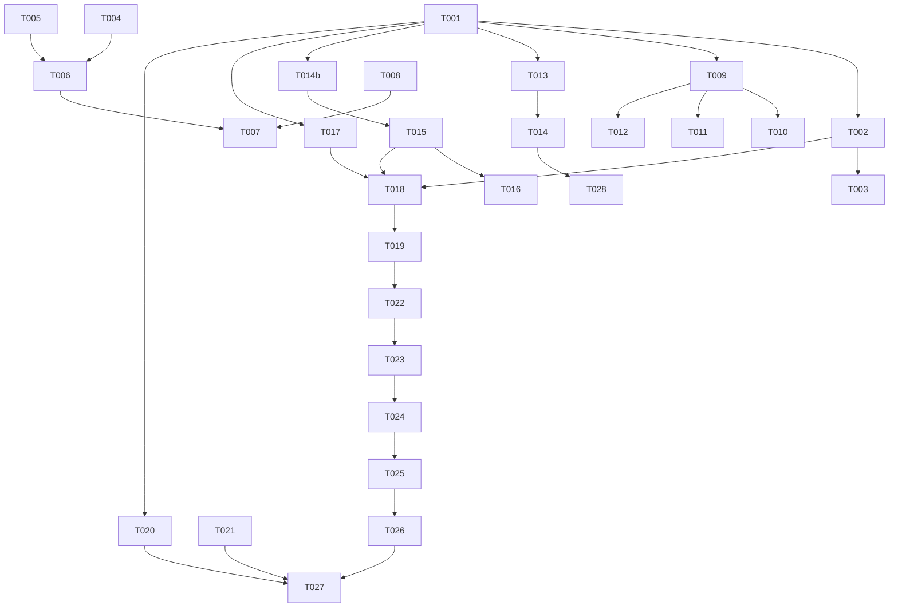

# Tasks: droid-notices-migration（桌面可迁移改动移植 + SnishaperDroid 公告通道）

**Input**: Design documents from `spec/droid-notices-migration/`
**Prerequisites**: plan.md (required), spec.md (required for user stories)

**仓库路径约定**（多仓库任务，路径前缀说明）：
- **Droid** = `D:\c++\Contributions\Snishaper-Droid`
- **Web** = `D:\WEB\dongzheyu.github.io`（SnishaperTeam/Website 本地克隆）
- **桌面版** = `D:\c++\Contributions\SniShaper-main`

## Path Conventions

- 多仓库任务：任务描述中的相对路径以前述仓库前缀解析；未带前缀的路径相对 `{PROJECT_ROOT}`（Droid 仓库根）
- Droid 源码：`gomobile/`（Go 内核）、`frontend-android/src/`（React 前端）、`app/src/main/`（Android 壳 + Kotlin bridge）、`.github/workflows/`（CI）
- Web 源码：根 `functions/` 与 `build/vue-app/functions/` 双树镜像（live 部署取后者）；公告数据 `build/vue-app/notices/`；管理后台 `build/vue-app/src/views/AdminView.vue`
- 桌面版：仅提交工作区已有未提交改动，不产生新文件

## Format: `[ID] [P?] [Story] Description`

- **[P]**: 可并行（不同文件、无未完成依赖）
- **[Story]**: 对应 spec.md 用户故事（US1–US6）
- 所有任务均给出确切文件路径

---

## Phase 1: Setup（环境预检）

- [X] T001 环境预检：确认 `go`、`node/npm`、`gh`（已认证 dongle-china）、`git` 可用；确认三仓库基线——Droid 工作区干净（除 spec/ 外）、Web 工作区有 2 个已修改文件（`functions/_lib/notices-store.ts`、`build/vue-app/functions/_lib/notices-store.ts`，属本次要提交的 admin-auth 改动，不得还原）、桌面版工作区有 3 个已修改文件（属本次要提交的 product=snishaper 改动，不得还原）

---

## Phase 2: User Story 1 - 安卓版公告功能 (Priority: P1) 🎯 MVP

**Goal**: 安卓 App 仪表盘展示 SnishaperDroid 通道官方公告（横幅 + 历史 + 缓存回退）
**Independent Test**: gomobile `go test` 通过；前端 `npm run build` 通过；Dashboard 可见 NoticeCenter

- [X] T002 [US1] 新建 `Droid\gomobile\mobile\notices.go`：移植桌面版 `桌面版\app\app_notices.go`——Notice/NoticesPayload 模型（字段与桌面完全一致）、`GetNoticesJSON(force bool) (out string)` 导出方法、端点 `https://jetcpp.ccwu.cc/api/notices?all=1&product=SnishaperDroid`、镜像 `https://cdn.jsdelivr.net/gh/SnishaperTeam/Website@main/build/vue-app/notices/SnishaperDroid.json`、缓存 TTL 10 分钟、请求超时 8 秒、磁盘缓存 `<dataDir>/config/notices_cache.json`、回退链 API→镜像→内存缓存→磁盘缓存（stale 标记）；去掉桌面版的 system-proxy 源（安卓无对应物）；在 `Droid\gomobile\mobile\app.go` 的 App 结构体追加公告缓存字段（互斥锁 + payload + 抓取时间），并在 NewApp 初始化
- [X] T003 [US1] `Droid\app\src\main\java\com\snishaper\android\webview\EngineBridge.kt`：dispatch 表增加 `"GetNotices" -> parse(app.getNoticesJSON(a.bool(0)))`（遵循现有 JSON passthrough 模式，`Args.bool` 助手已存在）
- [X] T004 [P] [US1] `Droid\frontend-android\src\api\bindings.ts`：增加 `export const GetNotices = (force: boolean) => appCall('GetNotices', force);`
- [X] T005 [P] [US1] `Droid\frontend-android\src\lib\icons.tsx`：确认并按需补充 `X`、`Info` 图标导出（`Megaphone`/`History`/`RefreshCw`/`ExternalLink` 已存在）
- [X] T006 [US1] 新建 `Droid\frontend-android\src\components\NoticeCenter.tsx`：移植桌面版 `桌面版\frontend\src\components\NoticeCenter.tsx`——未读横幅（级别配色 info/important/critical、置顶 Chip、多语言 title/body、外链按钮）、无未读时历史入口、历史 Modal（全部公告列表、过期置灰、刷新按钮、空态）、已读状态 localStorage 键 `snishaper.notices.read_ids`（上限 400）、stale 提示、`OpenURL` 外链（Droid bindings 已有）
- [X] T007 [US1] `Droid\frontend-android\src\pages\Dashboard.tsx`：在页面内容区顶部挂载 `<NoticeCenter />`（对齐桌面版 Dashboard 的挂载位置与布局节奏）
- [X] T008 [P] [US1] `Droid\frontend-android\src\i18n\locales\zh.json`、`en.json`、`ru.json`：移植桌面版 `桌面版\frontend\src\i18n\locales\*.json` 的 `notices.*` 文案键（pinned/more_unread/view_all/mark_read/history_entry/stale/title/subtitle/refresh/close/empty/expired/link_default 等），键名与桌面保持一致

---

## Phase 3: User Story 2 - Web 端 SnishaperDroid 公告产品通道 (Priority: P1)

**Goal**: 公告 API 支持 `product=SnishaperDroid`，管理后台可切换该通道
**Independent Test**: 本地检查 `targetFromProduct('SnishaperDroid')` 返回新 target；种子 JSON 结构合法

- [X] T009 [US2] `Web\functions\_lib\notices-store.ts`：仿照 FW_TARGET 模式增加 `DROID_TARGET`（`repo: 'SnishaperTeam/Website'`、`file: 'build/vue-app/notices/SnishaperDroid.json'`、`branch: 'main'`、`cacheKey: 'https://notices.jetcpp.ccwu.cc/api/notices?product=SnishaperDroid'`），`targetFromProduct` 增加 `if (product === 'SnishaperDroid') return DROID_TARGET`
- [X] T010 [US2] 同步镜像 `Web\build\vue-app\functions\_lib\notices-store.ts`：与 T009 完全一致（仓库双树镜像约定，live 部署取 build/vue-app/functions）
- [X] T011 [P] [US2] 新建 `Web\build\vue-app\notices\SnishaperDroid.json`：空公告文档种子（结构参照 `flowweaver.json`：`version`/`updated_at`/`notices: []`）
- [X] T012 [P] [US2] `Web\build\vue-app\src\views\AdminView.vue`：`NoticeProduct` 类型联合增加 `'SnishaperDroid'`，`noticeProducts` 数组增加 `{ key: 'SnishaperDroid', label: 'Snishaper Droid' }`（沿用现有 product-switch 交互，无需新样式）

---

## Phase 4: User Story 3 - 安卓发版流水线自动发版公告 (Priority: P1)

**Goal**: release workflow publish 阶段自动向 SnishaperDroid 通道发布 Commit 内容发版公告
**Independent Test**: YAML 语法解析通过；`gh secret list` 可见两个 secrets

- [X] T013 [US3] `Droid\.github\workflows\release.yml`：publish 任务增加公告发布——(a) job env 增加 `ANNOUNCEMENT_READY: ${{ secrets.ANNOUNCEMENT_ADMIN_EMAIL != '' && secrets.ANNOUNCEMENT_ADMIN_PASSWORD != '' }}` 及两个 secret 透传；(b) 在 GitHub Release 创建步骤之后新增 "Publish release announcement" 步骤（`if: env.ANNOUNCEMENT_READY == 'true'`、`continue-on-error: true`）：从 `RELEASE_NOTES.md` 提取"## 变更 / Changelog"段作为正文（>1600 字符截断加 `...`），组装公告对象（`id: release-<tag>` 幂等、`title: Snishaper-Droid <version> 发布`、`level: 预发布 info / 正式 important`、`link: release 页面 URL`、`link_text: 查看本次发行说明`、`pinned: false`），`POST https://jetcpp.ccwu.cc/api/admin/session` 登录取 token，`POST https://jetcpp.ccwu.cc/api/notices?product=SnishaperDroid`（Bearer token）；不使用 AI 摘要
- [X] T014 [US3] 用 gh CLI 写入 Droid 仓库 secrets：`gh secret set ANNOUNCEMENT_ADMIN_EMAIL --body "youmao2023@outlook.com" --repo SnishaperTeam/snishaper-droid` 与 `gh secret set ANNOUNCEMENT_ADMIN_PASSWORD --body "DZY@013520" --repo SnishaperTeam/snishaper-droid`，然后 `gh secret list --repo SnishaperTeam/snishaper-droid` 验证

---

## Phase 5: User Story 4 - 默认规则完整保真迁移 (Priority: P2)

**Goal**: 安卓默认规则以完整保真方式对齐桌面当前版（226 组，保留 mitm/sni_fake/cert_verify/ECH/官方 IP）
**Independent Test**: 重新生成的 rules.json 分组数 226、含 mitm/quic 与 sni_fake 字段；`go test` 通过

- [X] T014b [US4] `Droid\gomobile\cmd\gen-defaults\main.go`：移除 `sanitizeRulesConfig` 中 site_groups 的 CA-free 清洗逻辑（取消 mitm/quic→tls-rf 的 mode 改写、取消 sni_fake/cert_verify/ECH 系列字段剥离；保留 settings 的安卓覆盖逻辑不变），更新文件头注释与打印文案（不再是 "CA-free"）
- [X] T015 [US4] 用更新后的 gen-defaults 重新生成默认规则：`go run ./cmd/gen-defaults -desktop-rules "D:\c++\Contributions\SniShaper-main\rules\config.json" -desktop-settings "D:\c++\Contributions\SniShaper-main\config\settings.json" -assets "..\..\app\src\main\assets\defaults"`（在 `Droid\gomobile` 目录执行），确认产物 `Droid\app\src\main\assets\defaults\rules.json` 为 226 组、模式分布 mitm 78 / tls-rf 118 / quic 9 / transparent 20 / direct 1、含 sni_fake 与 cert_verify 字段、config_version 1
- [X] T016 [US4] `Droid\gomobile\mobile\sanitize_test.go`：默认规则分组数断言 `222` → `226`

---

## Phase 6: User Story 5 - snishaper-core 升级 v0.8.5 (Priority: P2)

**Goal**: 内核依赖与版本常量对齐桌面版（MITM 上游 SNI 修复）
**Independent Test**: `go build ./...` 通过；app.go 中 coreVersion 显示 v0.8.5

- [X] T017 [P] [US5] `Droid\gomobile\go.mod`：`github.com/SnishaperTeam/snishaper-core` `v0.8.4` → `v0.8.5`（执行 `go mod tidy` 同步 `go.sum`）；`Droid\gomobile\mobile\app.go`：`coreVersion = "v0.8.4"` → `"v0.8.5"`

---

## Phase 7: User Story 6 - 文档整理与三仓库提交 (Priority: P3)

**Goal**: 文档同步 + 三个仓库的本次改动全部入库（只 commit 不 push）
**Independent Test**: 三仓库 `git status` 在本次范围内干净；`git log -1` 提交信息符合各仓库 conventional commits 风格

- [X] T018 [P] [US6] `Droid\CHANGELOG.md`：增加本次改动条目（公告功能、SnishaperDroid 通道、规则保真迁移 226 组、core v0.8.5、发版公告自动化），风格对齐现有条目
- [X] T019 [P] [US6] 检查 Droid 仓库文档中已过时的 "CA-free defaults" 表述并更新（`README.md`、`README_EN.md`、`docs/` 若有提及，改为"完整保真默认规则"表述；EngineBridge.kt 头注释中的 "CA-free gomobile AAR" 一并修正）
- [X] T020 [P] [US6] 桌面版仓库提交：将工作区 3 处已修改文件（`app\app_notices.go`、`.github\workflows\_release_pipeline.yml`、`docs\portable-updater.md`）提交，提交信息 `feat(notices): scope the announcement endpoints to the snishaper product`
- [X] T021 [P] [US6] Web 仓库提交：T009–T012 的新通道改动 + 工作区已有 2 处 admin-auth 改动，提交信息 `feat(notices): add SnishaperDroid product channel`
- [ ] T022 [US6] Droid 仓库提交：全部本次改动（代码 + `spec/` 规格文档），按仓库风格拆分——`feat(android): port the desktop notices feature and add the SnishaperDroid announcement channel`（代码一条，spec 文档可并入或单独 `docs(spec)` 一条）

---

## Phase 8: Verification

<!-- verification_scope: build-only -->

**Purpose**: 构建/测试/提交完整性验证（不推送、不装机 UI 验证——按用户选择的 build-only 范围）

- [ ] T023 构建验证（gomobile）：在 `Droid\gomobile` 执行 `go build ./...` 与 `go test ./...`，修复所有编译/测试错误直到通过（重点：notices.go 编译、sanitize_test 226 断言、app_test 对 testdata 的兼容）
- [ ] T024 构建验证（前端）：在 `Droid\frontend-android` 执行 `npm run build`（tsc + vite），修复所有类型/构建错误直到通过（重点：NoticeCenter.tsx 类型、i18n 键完整性、Dashboard 挂载）
- [ ] T025 构建验证（Android 全链路）：按 `Droid\scripts` 现有脚本重建 gomobile AAR 并执行 `gradlew assembleDebug`（验证 EngineBridge 分派与 Kotlin 编译链路；若本机缺少 gomobile/NDK 工具链，记录说明并以 T023/T024 为准）
- [ ] T026 构建验证（Web）：对 `Web` 仓库的 functions TypeScript 运行类型检查（若仓库配置了相应脚本则执行；否则用 tsc --noEmit 对改动文件所在项目做最小验证）
- [ ] T027 提交完整性验证：三仓库分别 `git status`（本次范围内无未提交残留）+ `git log -1 --stat` 核对提交内容；确认三仓库均未 push（`git status` 无 ahead 提示或提示用户推送时机）
- [ ] T028 secrets 验证：`gh secret list --repo SnishaperTeam/snishaper-droid` 确认 ANNOUNCEMENT_ADMIN_EMAIL / ANNOUNCEMENT_ADMIN_PASSWORD 存在

---

## 📊 Dependency Graph & Execution Order

**执行顺序**：T001（预检）→ US1–US5 可按依赖图交错推进 → US6（文档+提交，Droid 提交最后汇总）→ Verification（构建链串行修错）。

**阶段依赖**：
- Setup（T001）阻塞全部
- US1 内部：T002→T003（Go→bridge）；T004/T005/T008→T006→T007（前端链）
- US2 内部：T009 先行 → T010/T011/T012 跟进
- US4 严格串行：T014b→T015→T016
- US6 的 Droid 提交（T022）依赖全部 Droid 代码/文档任务完成
- Verification 依赖 US6 提交完成（T027 校验提交完整性）

## ⚡ Parallel Execution Guide

| Phase | Tasks | Required Files | Execution Notes |
|-------|-------|----------------|-----------------|
| Setup | T001 | 三仓库根目录 | 串行预检，一次完成 |
| US1 | T002 ∥ T004/T005/T008 | gomobile ∥ frontend | Go 侧与前端文案/图标可并行；T003 依赖 T002 方法名 |
| US2 | T009 → (T010, T011, T012) | Web 仓库 | T009 先行，镜像与种子/AdminView 并行跟进 |
| US3 | T013 → T014 | release.yml + gh CLI | T014 依赖 T013 的 secret 名称定案 |
| US4 | T014b → T015 → T016 | gen-defaults + assets | 严格串行（工具→产物→断言） |
| US5 | T017 | go.mod/go.sum/app.go | 独立，可与任何 US 并行 |
| US6 | T018/T019 → T020 ∥ T021 → T022 | 三仓库 | Droid 提交最后（汇总全部代码改动） |
| Verification | T023 → T024 → T025 → T026 → T027, T028 | 构建产物 | 构建链串行修错；T028 独立 |

## Notes（Implementation Strategy）

- **MVP 优先**：US2（Web 通道）+ US1（App 公告）构成最小可用闭环——通道就绪后 App 即可取到公告；US3 补充发版内容来源；US4/US5 为与桌面版一致性收尾
- **增量交付**：每个故事完成后有独立构建/检查手段，可随时停下验证
- **提交纪律**：三仓库只 commit 不 push；push 时机由用户事后确认（push 会触发线上部署与 CI）
- **不还原工作区**：Web 仓库 2 处、桌面版 3 处未提交改动是本次要保留并提交的内容，任何操作不得 checkout/restore 丢弃它们
- **回归红线**：不修改 Web 仓库已部署的其他 API 行为；不改动 Droid 现有桥接方法语义；gen-defaults 保留 settings 安卓覆盖

## Summary Report

- **总任务数**：28（T001–T028，含 T014b）
- **按故事**：US1×7、US2×4、US3×2、US4×3、US5×1、US6×5、Setup×1、Verification×6
- **并行机会**：US1 内 Go/前端两线；US2 内种子/AdminView 随主改动；US5 全程独立；US6 内桌面版/Web 提交并行
- **独立测试标准**：每个故事有独立构建/检查手段（见各 Phase 的 Independent Test）
- **MVP 范围建议**：US2（通道）+ US1（App 公告）为最小可用闭环；US3 补充内容来源；US4/US5 为一致性收尾
